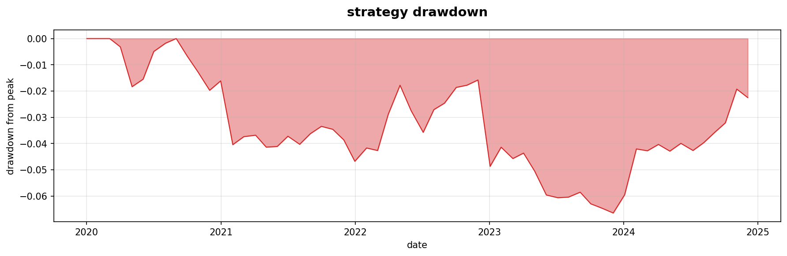

# momentum-equity-research


**Does 12-month momentum still earn a premium on large-cap US stocks once you charge realistic trading costs, and how does it compare with short-term mean reversion on the same data?**

Short answer: costs turned out to be the smaller problem. A 5-stock long/short momentum book earns a positive average month (+1.5% net, 62% of months profitable), but it's so concentrated that two "momentum crashes" wipe it out. In those months the beaten-down short basket rallied violently: −54% in Feb 2021 and −92% in Jan 2023. Compounded, the strategy loses 78% over 2020–2024, and none of the results are statistically significant.

> **Revision note (Nov 2026):** while re-checking the results I found a bug in my own backtest. It averaged daily returns within each holding period instead of compounding them, which understated volatility (2.9% vs the true 69%) and made transaction costs look like the main story. I fixed it in `backtest.py`, re-ran every number and chart, and the conclusion changed: concentration and crash risk, not costs, are what break this strategy.

## Data and period

- **Universe:** S&P 500 constituents (~500 tickers, scraped from Wikipedia), plus SPY/QQQ as benchmarks
- **Prices:** daily adjusted closes from yfinance, Jan 2019 – Dec 2024
- **Backtest windows:** momentum 2020–2024 (60 monthly rebalances; the first year is used up by the 12-month lookback), mean reversion 2019–2024 (71 rebalances)

## Method, in plain English

1. **Every month** (every 21 trading days), rank all stocks by a signal.
   - **Momentum:** return from 12 months ago to 1 month ago. Skipping the last month is the standard "12-1" specification (Jegadeesh & Titman, 1993).
   - **Mean reversion:** last month's return, inverted, so the biggest recent losers rank highest (Jegadeesh, 1990).
2. **Go long the top 5 and short the bottom 5**, equal-weighted.
3. **Hold for the next 21 trading days**, then rebalance.
4. **Charge 10 bps round-trip per rebalance**, assuming full turnover on both legs. This is conservative, because some names stay in the basket.
5. **Test whether it's real:** one-sample t-test on each return series, plus a time split at Jan 2023 to check stability.

## Results

Monthly long/short returns, 10 bps round-trip cost per rebalance:

| metric | momentum net | momentum gross | mean-rev net | mean-rev gross |
|---|---|---|---|---|
| total return | −78.1% | −76.4% | −52.8% | −49.3% |
| annualised return (arithmetic) | 18.4% | 19.6% | 5.7% | 6.9% |
| annualised vol | 69.2% | 69.2% | 62.1% | 62.1% |
| Sharpe ratio | 0.27 | 0.28 | 0.09 | 0.11 |
| max drawdown | −94.9% | −94.6% | −78.7% | −77.9% |
| hit rate | 61.7% | 61.7% | 56.3% | 57.7% |
| t-statistic (p-value) | 0.59 (0.55) | 0.63 (0.53) | 0.22 (0.82) | 0.27 (0.79) |

Periods: 60 for momentum (2020–2024; the first year is used up by the lookback) and 71 for mean reversion (2019–2024).

**Why a positive average month still loses 78%:** volatility drag. With monthly returns swinging ±20%, the arithmetic mean says very little about compounded wealth. One −92% month needs a +1,150% month to recover.

**What actually happened in the crashes:**

| month | long basket | short basket | long − short |
|---|---|---|---|
| Feb 2021 | MRNA, TSLA, CRWD, TTD, CVNA: −16.8% | OXY, NCLH, CCL, APA, ECHO: +37.3% | −54.1% |
| Jan 2023 | OXY, TPL, SMCI, EQT, FSLR: +2.0% | CVNA, APP, COIN, GNRC, ALGN: +94.1% | −92.1% |

Both are the pattern documented by Daniel & Moskowitz (2016, *Momentum Crashes*): after a sharp market reversal, the past losers you're short rebound hardest. With only 5 names on the short side, nothing dilutes it.

**Stability (split at Jan 2023, chosen before looking at either half):**

| | 2020–2022 gross Sharpe | 2023–2024 gross Sharpe |
|---|---|---|
| momentum | 0.43 | 0.14 |
| mean reversion | −0.24 | +0.67 |

**What this says:**
- **Costs aren't the binding constraint.** 10 bps a month is small next to a 1.6% mean monthly return. Gross and net Sharpe are nearly identical (0.28 vs 0.27).
- **Concentration and crash risk are.** The momentum edge looks real month to month (62% hit rate), but a 5×5 book can't survive the left tail.
- **Mean reversion flips sign between regimes**, from losing pre-2023 to strongly positive after. That suggests regime-dependence rather than an absent effect, though with 24–47 periods per half it's suggestive, not conclusive.
- **Nothing is statistically significant.** Five years of monthly data isn't enough power for effects this noisy.

## Look-ahead bias controls

| Control | Where | Why it matters |
|---|---|---|
| Signal on day T uses only prices up to T | `signals.py`: `prices.shift(skip) / prices.shift(lookback)` | The ranking can't peek at prices that wouldn't have existed yet when the trade was placed |
| Returns are earned from T+1, never on day T | `backtest.py`: `forward_returns = daily_returns.shift(-1)` | Using the same day's return both to form the signal and to score it is the classic look-ahead bug, and it inflates results |
| Holding periods don't overlap | 21-day rebalance, 21-day hold | Each month's return is measured on fresh data, so no observation is counted twice |
| Signal parameters come from the literature, not tuning | 12-1 momentum, 1-month reversal | Searching over lookbacks until something works is look-ahead by another name (data snooping) |
| Out-of-sample split date fixed in advance | `oos_split.py`: `SPLIT_DATE = "2023-01-01"` | Picking the split after seeing results would let hindsight choose the "good" period |
| Net and gross results reported side by side, with significance tests | `compare_signals.py`, `significance_test.py` | Keeps a gross number that looks good from being read as a tradable result |

**Known gaps** (not yet controlled):
- **Survivorship bias:** the universe is *today's* S&P 500 list, so stocks removed from the index during 2019–2024 are missing. This is itself a form of look-ahead, because it uses knowledge of which companies survived. The fix is point-in-time constituent lists.
- **Forward-filled prices:** halted or suspended stocks carry a stale price, which shows up as zero return instead of being excluded.

## Limitations

- Only 5 years of data, so there's low power to detect effects this noisy
- Only 5 names per side, so results are dominated by a handful of stocks
- Flat 10 bps cost model, not based on actual per-stock spread or liquidity data
- No separate borrow cost on the short leg, which matters for heavily shorted names like CVNA and COIN

## Next steps

- **Diversify the book:** long/short deciles (~50 names per side) instead of 5, the standard academic construction
- **Volatility scaling / crash protection:** scale exposure down when recent strategy volatility spikes (Barroso & Santa-Clara, 2015; Daniel & Moskowitz, 2016)
- Point-in-time index membership to remove survivorship bias
- Borrow-cost modeling for the short leg
- Longer history for more statistical power

## More charts




## How to run

```bash
git clone https://github.com/Hena3124/momentum-equity-research
cd momentum-equity-research
pip3 install -r requirements.txt
python3 data.py              # download/cache S&P 500 prices
python3 backtest.py          # momentum backtest (net + gross)
python3 compare_signals.py   # momentum vs mean reversion
python3 significance_test.py # t-tests
python3 oos_split.py         # pre-2023 vs 2023+ stability
python3 charts.py            # regenerate charts
```

**Stack:** Python · pandas · NumPy · SciPy · yfinance · matplotlib · requests

<details>
<summary>What tripped me up</summary>

- **Look-ahead bias:** I fixed it by shifting returns forward one day so the portfolio only earns returns after the signal is computable.
- **Wikipedia 403s:** `pd.read_html()` alone was blocked without a User-Agent, so I fetch with `requests` first.
- **yfinance on 500 tickers:** batched the downloads into groups of 100.

</details>
