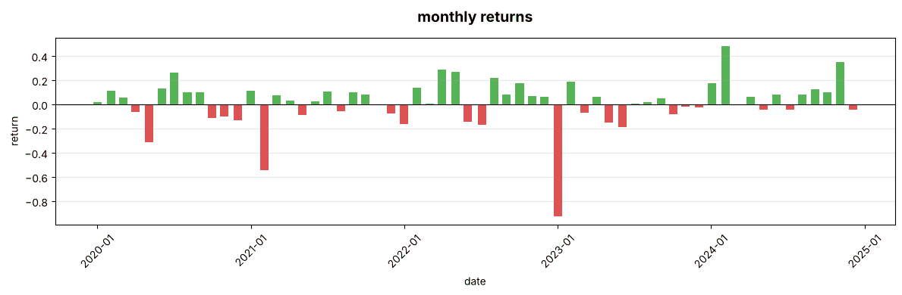

# momentum-equity-research

I got interested in quant finance a few months ago and kept seeing
"momentum" mentioned everywhere, in job descriptions, in research
papers, in interviews. I had no idea what it actually meant in
practice so I decided to just build it and find out.

This started as a small 18-stock backtest and has grown into a more
complete research project: a cross-sectional momentum strategy on
the full S&P 500, compared against a short-term mean-reversion
signal, with transaction costs, statistical significance testing,
and an out-of-sample stability check. Nothing here is groundbreaking
— the point was to actually build the full research pipeline myself
and be honest about what the results do and don't show.

## the idea

Stocks that have been going up over the past year tend to keep going
up (momentum). Stocks that have fallen recently tend to bounce back
over a much shorter horizon (mean-reversion). Both are well-documented
patterns in finance (Jegadeesh & Titman 1993 for momentum, Jegadeesh
1990 for short-term reversal) but they reflect opposite intuitions,
so I wanted to build both and see how they actually compare on the
same data rather than just taking the literature's word for it.

Momentum: ranks stocks by 12-month trailing return (skipping the most
recent month), goes long the top 5, short the bottom 5, rebalanced
monthly.

Mean-reversion: ranks stocks by 1-month trailing return, inverted —
goes long the biggest recent losers, short the biggest recent winners,
also rebalanced monthly.

## universe

Originally 18 hand-picked large-cap stocks. Now pulls the actual
current S&P 500 constituent list from Wikipedia (~500 tickers,
minus a handful that come back with no data — some IPOs/delistings
fall inside the 2019-2024 window). Bigger universe means a cleaner,
more representative signal instead of one built on 18 stocks I
happened to pick.

## transaction costs

Everything below is reported both **gross** (no costs, the old way I
was doing it) and **net** (after a 10bps round-trip cost assumption
per position per rebalance, meant to roughly capture bid-ask spread
and commissions on large-cap equities). This turned out to matter a
lot — see results below.

## results

60 monthly periods for momentum (2020-2024), 71 for mean-reversion
(2019-2024 — it needs a shorter lookback so more of the data is usable).

| metric | momentum net | momentum gross | mean-rev net | mean-rev gross |
|---|---|---|---|---|
| total return | -1.4% | 4.7% | -7.0% | -0.1% |
| annualised return | -0.2% | 1.0% | -1.2% | 0.0% |
| annualised vol | 2.9% | 2.9% | 2.7% | 2.7% |
| sharpe ratio | -0.08 | 0.34 | -0.45 | 0.00 |
| max drawdown | -6.6% | -4.0% | -8.2% | -4.7% |
| hit rate | 55.0% | 58.3% | 45.1% | 56.3% |

**Momentum has a real, modest gross edge** — 0.34 Sharpe and a 58.3%
hit rate, consistent with what the literature would predict for a
simple 12-month specification. **A 10bps transaction cost assumption
is enough to erase it completely.** The math checks out: 10bps × 12
rebalances/year ≈ 1.2% annual drag, and gross annualised return (1.0%)
minus that drag lands almost exactly on the net result (-0.2%).

**Mean-reversion shows essentially no edge at all**, gross or net —
this isn't a cost story, there's just nothing there at this monthly
rebalance frequency and 1-month lookback.

## is the momentum edge actually real, or just noise?

With only 60 monthly observations, a 0.34 Sharpe could plausibly
happen by chance. I ran a one-sample t-test on each return series to
check.

| | momentum gross | momentum net | mean-rev gross | mean-rev net |
|---|---|---|---|---|
| t-statistic | 0.75 | -0.18 | 0.01 | -1.08 |
| p-value | 0.456 | 0.855 | 0.990 | 0.282 |

**None of these are statistically significant at the 5% level.**
Even momentum gross, the strongest result, isn't close. Honestly,
this makes sense once I thought about it — the academic literature
on momentum typically uses decades of data across much broader
universes. A 5-year window isn't enough statistical power to
confirm an edge this small, even if it's directionally real. This
is a genuine limitation, not something I'm trying to explain away.

## is it stable over time?

I split the backtest at a fixed date (Jan 2023, chosen before
looking at either half's results) to check whether the signals hold
up consistently or whether the full-sample numbers are hiding
something.

**Momentum held up reasonably well.** Gross Sharpe went from 0.38
(2020-2022) to 0.28 (2023-2024) — same sign, similar magnitude, mild
decay. Net Sharpe was negative in both halves (-0.08 and -0.09),
which matches the cost story above: the cost problem is structural,
not specific to one period.

**Mean-reversion's result was the interesting one.** Gross Sharpe was
-0.32 in the first period and +0.66 in the second — a complete flip.
This actually changes how I read the full-sample "no edge" result
from above: it wasn't a stable near-zero edge, it was a strongly
negative period and a strongly positive period roughly canceling
out. That's a more precise (and more honest) conclusion than "the
signal doesn't work" — it suggests real instability or regime-
dependence rather than a flatly absent effect. With only ~24-36
periods per half, I'd treat this as suggestive rather than
conclusive — small samples make flips like this easier to produce
by chance too.

## what tripped me up

**Look-ahead bias.** Easy to accidentally use future data in a
backtest — e.g. using the same day's return to generate the signal
*and* measure performance. Fixed by shifting forward returns by one
day so the portfolio only earns returns after the signal is
computable, not on the same day.

**Wikipedia blocking scraped requests.** `pd.read_html()` alone
returned a 403 — Wikipedia rejects requests with no User-Agent
header. Fixed by fetching the page manually with `requests` first
and handing the HTML to pandas.

**yfinance choking on 500 tickers at once.** Batched the download
into groups of 100 instead of a single call.

## what I'd do differently / try next

- add volatility scaling (size positions by inverse volatility)
- test a longer lookback / lower rebalance frequency to reduce
  turnover and see if that changes the cost picture
- proper borrow-cost modeling for the short side, not just a flat
  transaction cost
- Fama-French factor exposure analysis
- combine momentum and mean-reversion (or other signals) with an ML
  model instead of evaluating them separately
- test with a longer/older data window to get more statistical power

## charts





## how to run

```bash
git clone https://github.com/Hena3124/momentum-equity-research
cd momentum-equity-research
pip3 install -r requirements.txt
python3 data.py              # downloads/caches full S&P 500 price history
python3 signals.py           # inspect the momentum signal on the latest day
python3 backtest.py          # run the momentum backtest (net + gross)
python3 compare_signals.py   # momentum vs mean-reversion, net + gross
python3 significance_test.py # t-tests on all four return series
python3 oos_split.py         # pre-2023 vs 2023+ stability check
python3 charts.py            # generate the charts above
```

## stack
Python · pandas · NumPy · yfinance · matplotlib · scipy · requests

## limitations
- only 5 years of data (2019-2024) — not enough statistical power to
  confirm a small edge even if it's directionally real
- survivorship bias — the S&P 500 list is the *current* constituent
  list, so it doesn't include stocks that were removed from the index
  over 2019-2024
- transaction cost model is a flat 10bps assumption, not based on
  actual liquidity/spread data per stock
- short selling assumed to have no separate borrow cost beyond the
  flat transaction cost
- out-of-sample split uses fairly small samples per half (24-47
  periods), so the mean-reversion "flip" result should be treated
  as suggestive, not conclusive